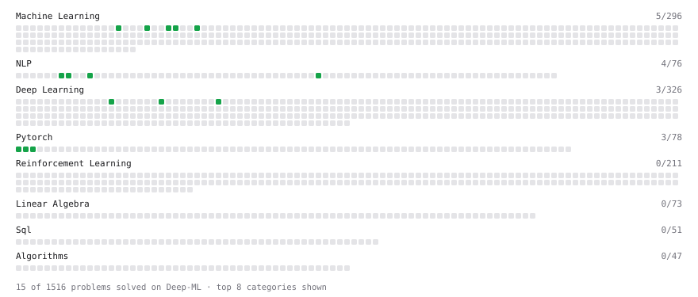

# Deep-ML

My machine learning practice from [Deep-ML](https://www.deep-ml.com). Every solution here was written by hand.

**20** solved · 20 problems · 0 labs · 0 math

[**Browse the interactive portfolio**](https://asaraiya7.github.io/deep-ml/) to replay this filling in over time.

## Problems

| | Difficulty | Solved | |
| --- | --- | --- | --- |
| [Add a Bias Vector to a Batch via Broadcasting](https://www.deep-ml.com/problems/882) | easy | 2026-10-07 | [solution](problems/0882-add-a-bias-vector-to-a-batch-via-broadcasting) |
| [Build Vocabulary from Token List](https://www.deep-ml.com/problems/941) | easy | 2026-10-12 | [solution](problems/0941-build-vocabulary-from-token-list) |
| [Calculate Accuracy Score](https://www.deep-ml.com/problems/36) | easy | 2026-10-04 | [solution](problems/0036-calculate-accuracy-score) |
| [Calculate Image Brightness](https://www.deep-ml.com/problems/70) | easy | 2026-10-12 | [solution](problems/0070-calculate-image-brightness) |
| [Calculate Perplexity for Language Models](https://www.deep-ml.com/problems/320) | easy | 2026-10-12 | [solution](problems/0320-calculate-perplexity-for-language-models) |
| [Calculate Root Mean Square Error (RMSE)](https://www.deep-ml.com/problems/71) | easy | 2026-10-04 | [solution](problems/0071-calculate-root-mean-square-error-rmse) |
| [Calculate Unigram Probability from Corpus](https://www.deep-ml.com/problems/129) | easy | 2026-10-12 | [solution](problems/0129-calculate-unigram-probability-from-corpus) |
| [Create a Float Tensor from a Python List](https://www.deep-ml.com/problems/880) | easy | 2026-10-07 | [solution](problems/0880-create-a-float-tensor-from-a-python-list) |
| [Exact Match Score with Normalization](https://www.deep-ml.com/problems/325) | easy | 2026-10-12 | [solution](problems/0325-exact-match-score-with-normalization) |
| [Implement 2D Average Pooling](https://www.deep-ml.com/problems/265) | easy | 2026-10-12 | [solution](problems/0265-implement-2d-average-pooling) |
| [Implement a Linear Layer Forward Pass with Matrix Multiplication](https://www.deep-ml.com/problems/883) | easy | 2026-10-13 | [solution](problems/0883-implement-a-linear-layer-forward-pass-with-matrix-multiplication) |
| [Implement a Simple Residual Block with Shortcut Connection](https://www.deep-ml.com/problems/113) | easy | 2026-10-07 | [solution](problems/0113-implement-a-simple-residual-block-with-shortcut-connection) |
| [Implement F-Score Calculation for Binary Classification](https://www.deep-ml.com/problems/61) | easy | 2026-10-04 | [solution](problems/0061-implement-f-score-calculation-for-binary-classification) |
| [Implement Global Average Pooling](https://www.deep-ml.com/problems/114) | easy | 2026-10-12 | [solution](problems/0114-implement-global-average-pooling) |
| [Implement Precision Metric](https://www.deep-ml.com/problems/46) | easy | 2026-10-04 | [solution](problems/0046-implement-precision-metric) |
| [Implement Recall Metric in Binary Classification](https://www.deep-ml.com/problems/52) | easy | 2026-10-04 | [solution](problems/0052-implement-recall-metric-in-binary-classification) |
| [Implement the Hard Sigmoid Activation Function](https://www.deep-ml.com/problems/96) | easy | 2026-10-05 | [solution](problems/0096-implement-the-hard-sigmoid-activation-function) |
| [KL Divergence Between Two Normal Distributions](https://www.deep-ml.com/problems/56) | easy | 2026-10-07 | [solution](problems/0056-kl-divergence-between-two-normal-distributions) |
| [Mean Pooling Over Sequence Embeddings for Classification](https://www.deep-ml.com/problems/1063) | easy | 2026-10-12 | [solution](problems/1063-mean-pooling-over-sequence-embeddings-for-classification) |
| [Reshape and Transpose a Tensor](https://www.deep-ml.com/problems/881) | easy | 2026-10-07 | [solution](problems/0881-reshape-and-transpose-a-tensor) |

---

_This file is regenerated by Deep-ML on every push._
